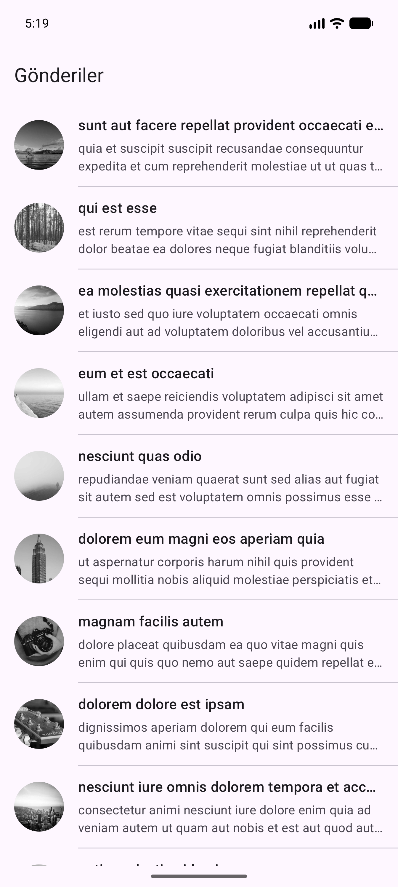
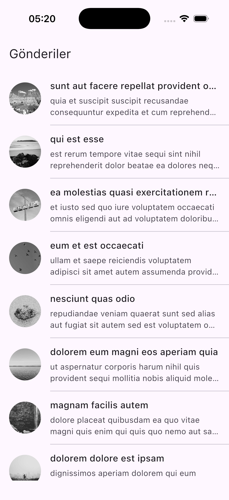
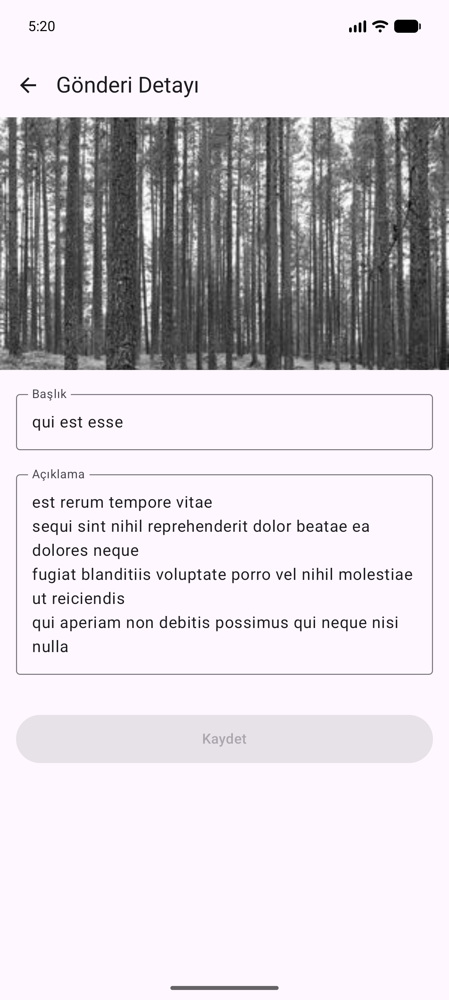
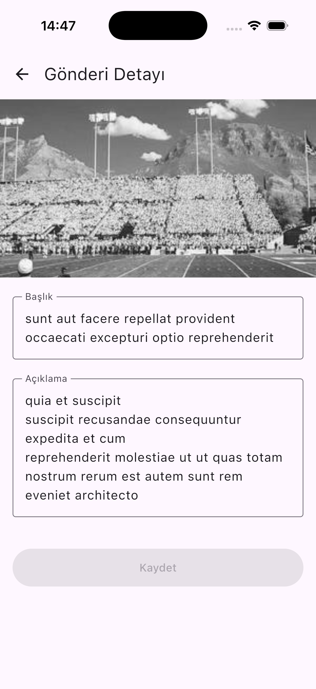
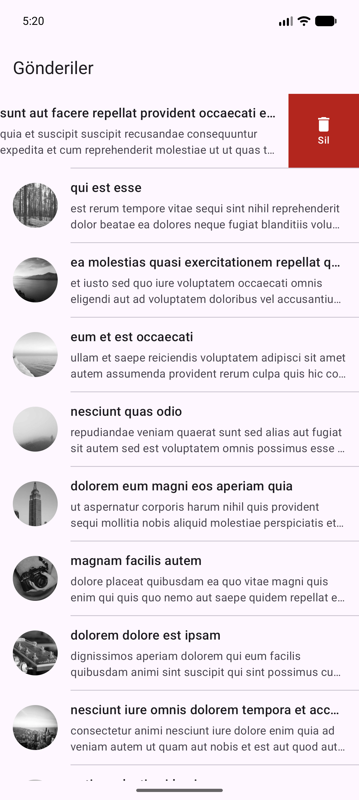
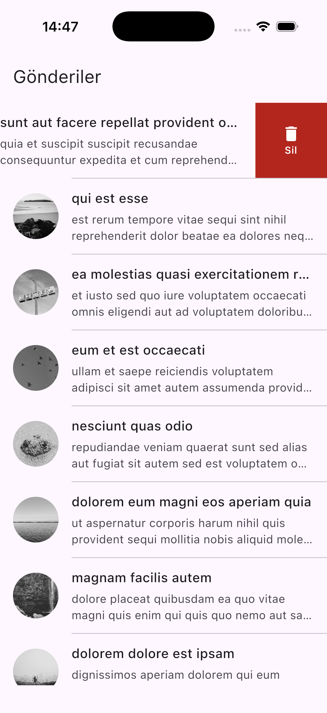

# NGamingCase

[JSONPlaceholder](https://jsonplaceholder.typicode.com/) üzerinden gönderileri listeleyen, düzenleyen ve silen bir **Kotlin Multiplatform + Compose Multiplatform** uygulaması. Android ve iOS aynı ortak kod tabanını (`commonMain`) paylaşır.

## Ekran Görüntüleri

| | Android | iOS |
|---|---|---|
| Gönderi listesi |  |  |
| Gönderi detayı |  |  |
| Kaydırarak silme |  |  |

## Özellikler

- **Gönderi listesi:** `GET /posts` ile gönderiler çekilir; her satırda görsel, başlık ve açıklama gösterilir. Görseller `picsum.photos` üzerinden gri tonlamalı olarak yüklenir.
- **Kaydırarak silme:** Satır sola kaydırıldığında "Sil" aksiyonu açılır. Silme iyimser (optimistic) olarak uygulanır; istek başarısız olursa gönderi eski yerine geri konur. Snackbar üzerinden geri alma desteklenir.
- **Detay / düzenleme:** Başlık ve açıklama düzenlenip `PUT /posts/{id}` ile kaydedilir. "Kaydet" butonu yalnızca alanlar boş değilse ve bir değişiklik varsa aktif olur.
- **Durum yönetimi:** Yükleniyor ve hata durumları ele alınır; tek seferlik olaylar (kaydedildi, silme başarısız vb.) ayrı bir event akışı ile UI'a iletilir.

## Kullanılan Teknolojiler

| Alan | Teknoloji | Sürüm |
|---|---|---|
| Dil | Kotlin (Multiplatform) | 2.4.21 |
| UI | Compose Multiplatform + Material 3 | 1.12.2 / 1.9.0 |
| Navigasyon | Navigation Compose (tip güvenli, `@Serializable` rotalar) | 2.10.0 |
| Mimari | MVVM — AndroidX Lifecycle ViewModel (multiplatform) | 2.11.0 |
| Bağımlılık enjeksiyonu | Koin (`koin-compose`, `koin-compose-viewmodel`) | 4.2.2 |
| Ağ | Ktor Client (OkHttp — Android, Darwin — iOS), ContentNegotiation, Logging, HttpTimeout | 3.6.1 |
| Serileştirme | kotlinx.serialization (JSON) | 1.12.0 |
| Asenkron | Kotlin Coroutines & Flow (`StateFlow`, `Channel`) | 1.10.2 |
| Görsel yükleme | Coil 3 (`coil-compose`, `coil-network-ktor3`) | 3.6.3 |
| Build | Gradle (Kotlin DSL), Version Catalog, AGP | AGP 9.5.0 |

**Platform hedefleri:** Android (minSdk 24, targetSdk 36, compileSdk 37) · iOS (`iosArm64`, `iosSimulatorArm64`, statik `ComposeApp` framework).

## Mimari

```
composeApp/src/
├── commonMain/                 # Paylaşılan tüm kod
│   ├── App.kt                  # MaterialTheme + NavHost
│   ├── navigation/Routes.kt    # PostListRoute, PostDetailRoute(postId)
│   ├── di/Koin.kt              # network / data / viewModel modülleri
│   ├── data/
│   │   ├── model/Post.kt
│   │   ├── remote/             # HttpClientFactory, PostApi
│   │   └── repository/         # PostRepository + Impl (StateFlow ile bellek içi kaynak)
│   └── ui/
│       ├── list/               # PostListScreen, PostItem, SwipeToDelete, PostListViewModel
│       └── detail/             # PostDetailScreen, PostDetailViewModel
├── androidMain/                # MainActivity, CaseApplication (Koin başlatma)
└── iosMain/                    # MainViewController (ComposeUIViewController)
iosApp/                         # SwiftUI giriş noktası (Xcode projesi)
```

- **Tek veri kaynağı:** `PostRepositoryImpl`, gönderileri bir `StateFlow` içinde tutar. Liste ve detay ekranları aynı kaynağı gözlemlediği için detayda yapılan güncelleme listeye anında yansır.
- **UI state + event ayrımı:** ViewModel'ler kalıcı ekran durumunu `StateFlow<UiState>`, tek seferlik olayları ise `Channel` → `Flow` ile yayınlar.
- **Hata yönetimi:** `runCatchingCancellable` ile hatalar `Result` olarak döner; `CancellationException` yutulmaz.

## Çalıştırma

### Android

Android SDK yolunu `local.properties` içinde (`sdk.dir=...`) ya da `ANDROID_HOME` ile tanımlayın, ardından:

```bash
./gradlew :composeApp:installDebug
```

### iOS

`iosApp/iosApp.xcodeproj` projesini Xcode ile açıp bir simülatör seçerek çalıştırın ya da komut satırından:

```bash
xcodebuild -project iosApp/iosApp.xcodeproj -scheme iosApp -configuration Debug -destination 'platform=iOS Simulator,name=iPhone 17 Pro' build
```
